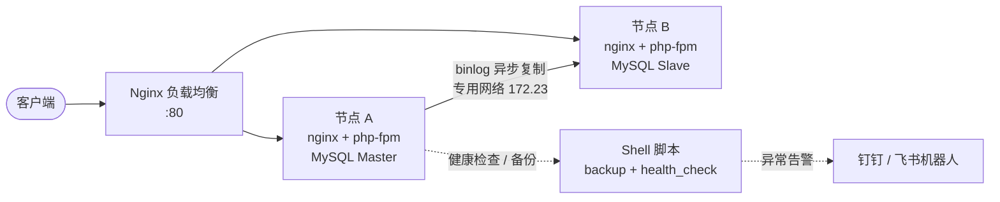
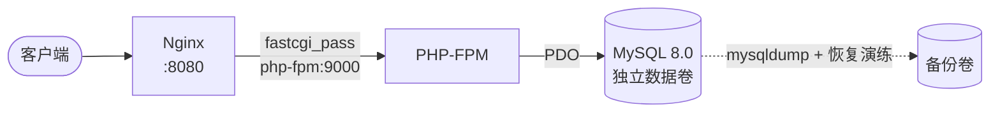

# ops-portfolio — 运维实战方案集

> 在**一台**腾讯云轻量服务器（2 核 2G / OpenCloudOS）上完整落地两套运维方案：
> 一套高可用 Web 集群，一套 Docker Compose 编排的 LNMP 生产环境。
> 全部配置、脚本、故障记录均在本机真实跑通过。

> ### ⚠️ 先说清楚边界（这段很重要，别删）
> 这是**个人在自有云服务器上搭建的实验环境**，不是公司项目。
> - 「集群」是用 **Docker 网络命名空间**在同一台机器上隔离出的 2 个节点 + 1 个负载均衡，
>   **内核参数、磁盘 IO、CPU 是共享的**，不等于两台物理机。
> - 受 2G 内存限制，MySQL 实例做了裁剪（buffer pool 96M、关 performance_schema），
>   **两个项目分时运行**，不同时启动。
> - 文中标注「待实测」的数字是本人尚未跑完的部分，**不会编数**。
>
> 面试时主动把这几条说出来，比藏着更可信——追问时藏不住的。

---

## 一、运行环境

| 项 | 值 |
|---|---|
| 云厂商 / 机型 | 腾讯云轻量应用服务器 |
| 配置 | 2 核 2G（**内存是全部设计的硬约束**） |
| 操作系统 | OpenCloudOS（CentOS 生态：dnf + firewalld + SELinux） |
| 核心组件 | Docker + Compose、Nginx、MySQL 8.0、PHP 8.x-FPM |
| 辅助 | Shell + crontab、钉钉/飞书机器人告警 |

---

## 二、项目一：高可用 Web 集群

**目标**：单机资源内做出「负载均衡 + 主从复制 + 自动备份 + 健康告警 + 故障演练」的完整链路。



**做了什么**

| 能力 | 实现方式 | 关键参数 / 说明 |
|---|---|---|
| 网络隔离 | 4 个自定义 Docker 网络 | 前端 172.20、节点内网 172.21/172.22、主从专网 172.23 |
| 负载均衡 | Nginx `upstream` + `least_conn` | 带 `max_fails` / `fail_timeout` 被动健康检查 |
| MySQL 主从 | 基于 GTID 的异步复制 | `server-id` 区分、`read_only` 从库 |
| 内存裁剪 | 每实例约 220MB | `innodb_buffer_pool_size=96M`、`performance_schema=OFF`、`max_connections=60` |
| 自动备份 | `backup.sh` + crontab 每日 02:00 | 全量 dump + gzip + 保留策略 |
| 健康告警 | `health_check.sh` 每 5 分钟 | 容器存活 / 主从延迟 / 磁盘水位 → 机器人推送 |
| 故障演练 | 6 个可复现场景 | 端口占用、属主错误、SELinux AVC、磁盘满、参数废弃、主从 1062 冲突 |

**已知短板（写进文档里的）**
- 无 VIP / Keepalived，**LB 是单点**——故障演练手册里专门做了 LB 挂掉的演练并记录影响面
- 主从复制是**异步**的，主库宕机存在数据丢失窗口，`failover_drill.sh` 是手工切换，未做自动选主

---

## 三、项目二：Docker Compose 编排 LNMP



**做了什么**

| 能力 | 说明 |
|---|---|
| 一键编排 | 单条 `docker compose up -d` 拉起 nginx / php-fpm / mysql 三容器 |
| 依赖与健康检查 | `depends_on` + `healthcheck`，避免 PHP 在 MySQL 就绪前连上来 |
| 慢 SQL 优化 | 造 10 万行数据 → `EXPLAIN` 对比 → 建索引 → `bench.sh` 量化优化前后耗时 |
| 备份与恢复演练 | `mysql_backup.sh` 定时备份，`restore_test.sh` **真的恢复一遍并校验行数** |
| PHP 参数调优 | `php.ini` 里 opcache、上传限制、慢日志路径 |

---

## 四、目录结构

```
ops-portfolio/
├── README.md                        # 执行手册（D0–D7，逐条命令级）
├── 00-init-server.sh                # 服务器初始化：swap、内核参数、Docker、目录
├── 01-SSH密钥登录与安全加固.md        # 密钥登录 / 禁密码 / 改端口 / SELinux
├── 02-GitHub仓库与服务器同步.md       # SSH Key / PAT / 空仓库反向上传
├── GitHub首页README.md              # ← 本文件，建议作为仓库首页 README.md
├── project1-cluster/                # 项目一：高可用集群
│   ├── docker-compose.yml
│   ├── nginx/       lb.conf node.conf
│   ├── mysql/       master.cnf slave.cnf
│   ├── app/         Dockerfile app.py
│   ├── sql/         init.sql
│   ├── scripts/     backup.sh health_check.sh setup_replication.sh
│   │                failover_drill.sh notify.sh
│   └── docs/        故障演练手册.md  故障复盘模板.md
├── project2-lnmp/                   # 项目二：LNMP
│   ├── docker-compose.yml
│   ├── nginx/conf.d/  php/  mysql/conf/  sql/  www/
│   ├── scripts/     bench.sh mysql_backup.sh restore_test.sh
│   └── docs/        SQL优化记录.md
├── docs/            架构说明.md  验收记录.md
└── interview/       高频追问与答法.md  命令与SQL速查.md  Linux场景面试题库.md
```

---

## 五、快速开始

```bash
# 1) 初始化服务器（加 swap、装 Docker、建目录）
bash /opt/ops/00-init-server.sh

# 2) 修换行符 + 加权限（Windows 编辑过的脚本必做）
cd /opt/ops && find . -name "*.sh" -exec sed -i 's/\r$//' {} \; -exec chmod +x {} \;

# 3) 按 README.md 的 D0–D7 逐日执行
```

> 完整步骤见 **`README.md`**（878 行，每一步都带命令、预期输出、失败处理）。

---

## 六、验收状态

| 项目 | 验收项 | 状态 |
|---|---|---|
| 服务器 | SSH 密钥登录 + 禁密码 + 改端口 | 待实测 |
| 服务器 | `sshd -T` 输出符合预期 | 待实测 |
| 项目一 | 7 个容器全部 Up，`curl /whoami` 返回节点名 | 待实测 |
| 项目一 | 主从 `Slave_IO_Running=Yes`、延迟 0 | 待实测 |
| 项目一 | 备份文件生成 + **恢复演练通过** | 待实测 |
| 项目一 | 告警机器人真的收到过一条 | 待实测 |
| 项目二 | 三容器 Up，`index.php` 能查到数据 | 待实测 |
| 项目二 | `bench.sh` 优化前后耗时对比 | 待实测 |

> 每项怎么验、预期输出长什么样，见 **`docs/验收记录.md`**——跑一项填一项。

---

## 七、踩过的坑（都写进文档了）

| 坑 | 现象 | 解法 |
|---|---|---|
| 腾讯云控制台防火墙 | 只配 `firewall-cmd`，外网照样进不来 | 控制台独立放行端口，五层排查法 |
| cron 的 PATH 极短 | 手动跑成功、挂 cron 就失败 | crontab 首行声明 PATH；`%` 要转义成 `\%` |
| MySQL 挂载目录属主 | 启动报 `Errcode 13` | `chown 999:999` |
| `sshd_config` 先匹配者生效 | 末尾追加 `PasswordAuthentication no` 不生效 | 先 sed 注释掉前面的 `yes`，用 `sshd -T` 验收 |
| GitHub 禁用密码认证 | `clone` 报 `Password authentication is not supported` | SSH Key 或 PAT |
| `ssh-agent -s` 不带 eval | `Could not open a connection to your authentication agent` | 默认路径无密码的密钥根本不需要 agent |

---

## 八、文档索引

| 文档 | 什么时候看 |
|---|---|
| `README.md` | **动手前先通读一遍**，D0–D7 逐日执行手册 |
| `01-SSH密钥登录与安全加固.md` | 配密钥登录、禁密码、改端口、SELinux |
| `02-GitHub仓库与服务器同步.md` | 代码上 GitHub / 服务器拉代码 |
| `docs/架构说明.md` | 想看两张架构图和设计取舍 |
| `docs/验收记录.md` | 跑完一项来这里填实测结果 |
| `project1-cluster/docs/故障演练手册.md` | 亲手造故障、练排查 |
| `project2-lnmp/docs/SQL优化记录.md` | 慢 SQL 优化前后对比 |
| `interview/高频追问与答法.md` | 面试前过一遍（口述题怎么答） |
| `interview/命令与SQL速查.md` | 面试前过一遍（命令和 SQL 怎么写） |
| `interview/Linux场景面试题库.md` | 简历挖坑点 + 场景题答题框架 |

---

## 九、License

MIT — 见 `LICENSE`。

> **给面试官的一句话**：这套东西在我自己的 2 核 2G 服务器上从头搭过一遍，
> 配置、脚本、故障记录和实测数据都在这个仓库里，可以逐条问我为什么这么选。
