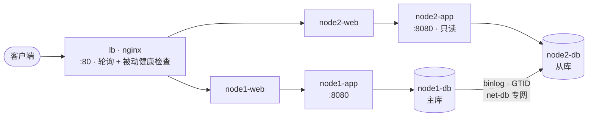

# ops-portfolio — 运维实战方案集

> 在**一台**腾讯云轻量服务器（2 核 2G / OpenCloudOS）上落地的两套方案：
> 一套高可用 Web 集群，一套 Docker Compose 编排的 LNMP。
> 配置、脚本、故障记录都在本仓库，且都在这台机器上真实跑过。

## 先说边界

这是**个人实验环境**，不是公司项目：

- 「集群」是用 Docker 网络隔离出的 2 个节点 + 1 个 LB，**CPU / 内存 / 磁盘是共享的**，不等于两台物理机
- 2G 内存是硬约束，MySQL 做了裁剪（buffer pool 96M、关 performance_schema），**两个项目分时运行**
- 标注「待做」的就是还没跑，**不编数字**

面试时主动交底，比被追问出来可信得多。

## 环境

| 项 | 值 |
|---|---|
| 机型 | 腾讯云轻量 2 核 2G |
| 系统 | OpenCloudOS（CentOS 生态：dnf + firewalld + SELinux） |
| 组件 | Docker + Compose、Nginx、MySQL 8.0（GTID 主从）、PHP 8.2-FPM |
| 自动化 | Shell + crontab、钉钉机器人告警 |

---

## 项目一：高可用 Web 集群

7 个容器、4 个自定义网络，模拟「LB + 2 节点 + MySQL 主从」。



| 能力 | 实现 | 关键点 |
|---|---|---|
| 网络隔离 | 4 个自定义 bridge | front 172.20 / 节点内网 172.21·172.22 / 复制专网 172.23 |
| 负载均衡 | Nginx upstream 轮询 | `max_fails=2 fail_timeout=10s` 被动摘除 + `proxy_next_upstream` 重试 |
| MySQL 主从 | GTID + ROW 异步复制 | `SOURCE_AUTO_POSITION=1`，从库 `read_only` |
| 读写分离 | 应用层 `READ_ONLY=1` | node2 的写请求直接 403，不打到从库 |
| 内存裁剪 | 单实例约 220MB | buffer pool 96M、`performance_schema=OFF`、max_connections 60 |
| 备份告警 | `backup.sh` / `health_check.sh` / `notify.sh` | crontab 02:00 备份、5 分钟巡检、钉钉推送 |
| 故障演练 | 7 个可复现场景 | 端口占用、属主错误、磁盘满、参数错、复制断裂、连接打满、nginx 抢跑退出 |

**已知短板**：无 VIP/Keepalived，**LB 是单点**；复制是异步的，主库宕机有丢数据窗口；切换靠 `failover_drill.sh` 手工执行。

---

## 项目二：Docker Compose 编排 LNMP

Nginx + PHP-FPM + MySQL 8.0 三容器，自定义网络 + 数据卷。

| 能力 | 说明 |
|---|---|
| 一键编排 | `docker compose up -d --build` 拉起三层 |
| 依赖控制 | `depends_on` + `healthcheck`，PHP 等 MySQL 真正就绪 |
| 慢 SQL 优化 | 30 万行压测数据 → `EXPLAIN` 对比 → 建索引 → `bench.sh` 量化 |
| 备份与恢复 | `mysql_backup.sh` 每日备份、7 天保留，`restore_test.sh` 真恢复并核对行数 |
| PHP 调优 | OPcache、上传限制、`pm.max_children=8` 适配 2G |

> 两个项目的 `notify.sh` 内容一致，改一处记得同步另一处。

---

## 目录

```
ops-portfolio/
├── README.md                  # 本文件：项目概览与索引
├── 00-init-server.sh          # 初始化：swap、内核参数、Docker、目录
├── docs/                      # 过程文档（按顺序读）
│   ├── 00-执行手册.md         # 公共准备 D0–D1 + 总览
│   ├── 01-服务器初始化与SSH加固.md
│   ├── 02-Git与仓库同步.md
│   ├── 03-Docker镜像与加速源.md
│   ├── 04-架构与取舍.md
│   ├── 05-验收记录.md
│   ├── 06-项目一执行步骤.md   # D2–D5：集群 / 主从 / 备份 / 演练
│   └── 07-项目二执行步骤.md   # D6–D7：LNMP / SQL 优化
├── scripts/mirror_probe.sh    # 镜像源探测
├── project1-cluster/          # 项目一：compose / nginx / mysql / app / scripts / docs
├── project2-lnmp/             # 项目二：compose / nginx / php / mysql / sql / scripts
└── interview/                 # 面试题库（见 interview/README.md）
```

## 快速开始

```bash
bash /opt/ops/00-init-server.sh                       # 初始化服务器
cd /opt/ops && find . -name "*.sh" -exec sed -i 's/\r$//' {} \; -exec chmod +x {} \;
# 然后按 docs/00-执行手册.md 完成 D0–D1（公共准备）
# 再选一个项目：
#   docs/06-项目一执行步骤.md（D2–D5）
#   docs/07-项目二执行步骤.md（D6–D7）
```

## 验收状态

| 项目 | 验收项 | 状态 |
|---|---|---|
| 服务器 | SSH 密钥登录 + 禁密码 + 改端口 | ✅ |
| 项目一 | 7 容器全部 Up，两个 db healthy | ✅ |
| 项目一 | 轮询生效（`/whoami` 交替返回节点） | ✅ |
| 项目一 | 主从数据同步（主库写、从库查到） | ✅ |
| 项目一 | 定时备份 + **恢复演练** | ⬜ 待做 |
| 项目一 | 告警真收到一条 | ⬜ 待做 |
| 项目一 | 故障演练（7 个场景） | 🔄 进行中 |
| 项目二 | 三容器 Up，页面能查到数据 | ⬜ 待做 |
| 项目二 | 慢 SQL 优化前后对比 | ⬜ 待做 |

逐项怎么验、预期输出，见 `docs/05-验收记录.md`。

## 踩过的坑

> 下表是速览，每条的现象、线索、根因、面试说法见 [`docs/08-踩坑与修复记录.md`](docs/08-踩坑与修复记录.md)。

| 现象 | 根因 | 解法 |
|---|---|---|
| 3 个 nginx 容器启动即退出 | 启动时就解析 upstream 主机名，抢跑时 DNS 还没注册 | `depends_on` 排顺序 + `restart: unless-stopped` |
| 从库 `SQL_Running: No` | dump 用了 `--all-databases --set-gtid-purged=OFF`，GTID 集合为空导致从头重放 | 只导业务库、保留 `GTID_PURGED`，先 `DROP DB` 再 `RESET MASTER` |
| MySQL 报 `Errcode 13` | 挂载的日志目录属主是 root，mysqld 以 uid 999 运行 | `chown -R 999:999 logs/mysql-*` |
| 页面「应用健康」永远失败 | `/health` 不在 `/api/` 前缀下，被 `location /` 吃掉返回 HTML | 加 `location = /health` 单独转发 |
| 页面刷新节点不切换 | 一次刷新发 4 个请求（偶数），轮询永远落在同一位 | 删掉多余请求；验证轮询用单请求 curl |
| 镜像 `manifest unknown` | 手写镜像域名前缀会绕过 registry-mirrors | 一律用官方原名，让 docker 自动换源 |
| cron 手动能跑、定时失败 | cron 的 PATH 极短 | crontab 首行声明 PATH，输出重定向到日志 |
| 云主机端口不通 | 只配了 `firewall-cmd`，云平台安全组没放行 | 两层都要配 |

## 文档索引

| 文档 | 什么时候看 |
|---|---|
| `docs/00-执行手册.md` | 动手前通读：三件事 + D0–D1 公共准备 |
| `docs/06-项目一执行步骤.md` | **项目一专用**：起集群 → 主从 → 备份告警 → 故障演练 |
| `docs/07-项目二执行步骤.md` | **项目二专用**：LNMP → 造数据 → 慢 SQL 优化 |
| `docs/01-服务器初始化与SSH加固.md` | 密钥登录、禁密码、改端口、SELinux |
| `docs/02-Git与仓库同步.md` | 代码上 GitHub、服务器拉代码 |
| `docs/03-Docker镜像与加速源.md` | 拉不动镜像时的四种解法 |
| `docs/04-架构与取舍.md` | 两张架构图 + 设计取舍 + 内存账 |
| `docs/05-验收记录.md` | 跑一项填一项 |
| `project1-cluster/docs/故障演练手册.md` | 亲手造故障、练排查 |
| `project2-lnmp/docs/SQL优化记录.md` | 慢 SQL 优化前后对比 |
| `docs/08-踩坑与修复记录.md` | **19 个真实故障的详解复盘**：现象→原理→定位→修法→换法对比→面试讲法 |
| `interview/README.md` | 面试题库索引与复习路径 |

## License

MIT — 见 `LICENSE`。

> 这套东西在我自己的 2C2G 服务器上从头搭过一遍，配置、脚本、故障记录和实测数据都在这个仓库里，可以逐条问为什么这么选。
