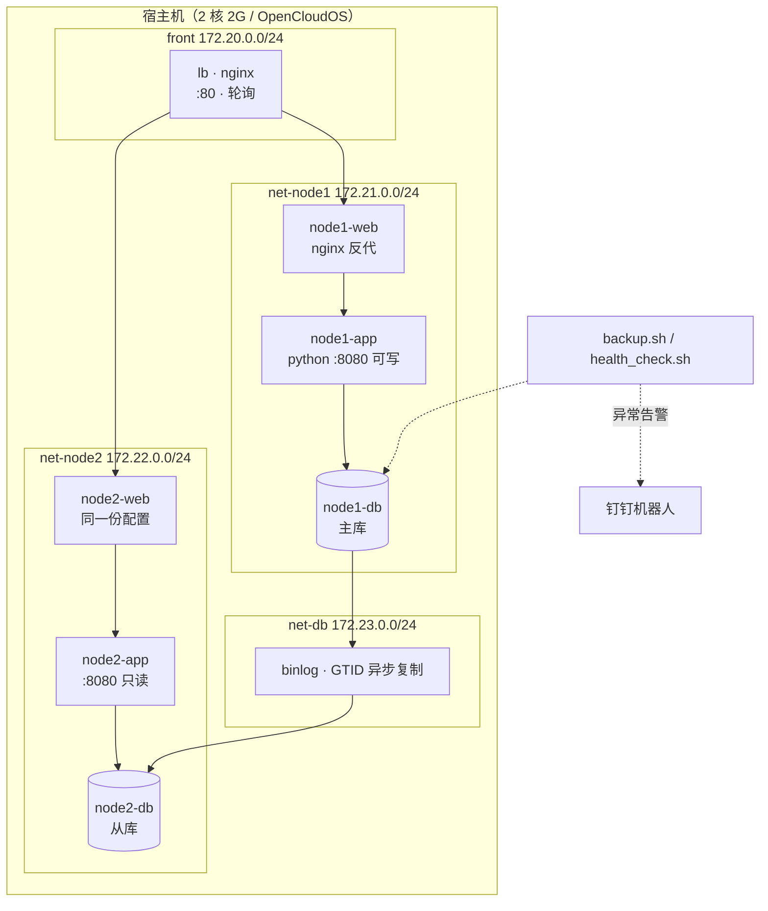

# 04 · 架构与取舍

> 回答「为什么这么设计」。面试问架构决策时照这页讲，重点是**代价**，别只讲好处。

## 项目一：高可用 Web 集群

### 关键决策

| 决策 | 选择 | 为什么 / 代价 |
|---|---|---|
| 多机怎么来 | **Docker 网络命名空间** | 轻量服务器不支持嵌套虚拟化。代价：内核与磁盘 IO 共享，**不是真多机** |
| 网络怎么切 | 4 个自定义 bridge | 前端 / 两个节点内网 / 主从专网；复制流量不占业务网，也便于单独抓包 |
| 调度算法 | **轮询（RR）** | 后端无状态，RR 最直观；要会话粘性才用 `ip_hash`，代价是负载不均 |
| 健康检查 | 被动（`max_fails=2` + `fail_timeout=10s` + `proxy_connect_timeout 1s`） | 开源版没有主动探测，零成本；代价是**切换窗口 2 秒**（`max_fails × connect_timeout`），期间有 2 次请求变慢但不报错 |
| 复制方式 | GTID 异步 | 切换时自动定位位点；代价是**主库宕机有丢数据窗口** |
| 读写分离 | 应用层 `READ_ONLY=1` | node2 读本节点从库、写请求直接 403；粗粒度，没有代理层路由 |
| 内存怎么省 | buffer pool 96M、关 performance_schema、max_connections 60 | 双实例要塞进 2G；代价是**性能数字不好看** |
| 两个项目 | **分时运行** | 2G 扛不住两套，这本身就是一个调度决策 |

### 明确没做的

- 没有 VIP / Keepalived → **LB 是单点**，演练手册里专门做了这一项
- 没有自动故障转移 → `failover_drill.sh` 手工切换，未上 MHA / Orchestrator
- 没有代理层读写分离（ProxySQL / MyCat）→ 只在应用层做了粗粒度控制

## 项目二：Compose 编排 LNMP

| 决策 | 选择 | 为什么 |
|---|---|---|
| 一容器一进程 | nginx / php / mysql 各一个 | 符合容器实践，便于单独扩缩与排错 |
| 服务依赖 | `depends_on` + `healthcheck` | `depends_on` 只保证「启动了」，不保证「能连」 |
| 数据持久化 | named volume | 避开宿主机目录属主（uid 999）这一大类坑 |
| 配置与代码 | bind mount（配置 `:ro`） | 改代码立即生效，配置进 Git |
| 慢 SQL 定位 | 30 万行数据 + `EXPLAIN` + 慢日志 | 没有真实流量只能自己造，才有对比基准 |
| 备份 | `mysqldump` 逻辑备份 | 数据量小够用；**大库该用 XtraBackup 物理备份**，要主动讲 |

## 内存账（面试能报的数字）

| 组件 | 项目一（同时运行） | 项目二（单独运行） |
|---|---|---|
| Nginx | ~15MB × 3 | ~15MB |
| PHP-FPM | —（项目一是 python app，约 25MB × 2） | ~40MB |
| MySQL | ~220MB × 2 | ~280MB |
| 系统 + Docker | ~400MB | ~400MB |
| **合计** | **~1.1 GB** | **~0.8 GB** |
| 2G 余量 | 紧张，靠 2G swap 兜底 | 较宽松 |

> swap 必加：`mysqldump` 峰值内存会顶上去，没有 swap 会被 OOM kill。
