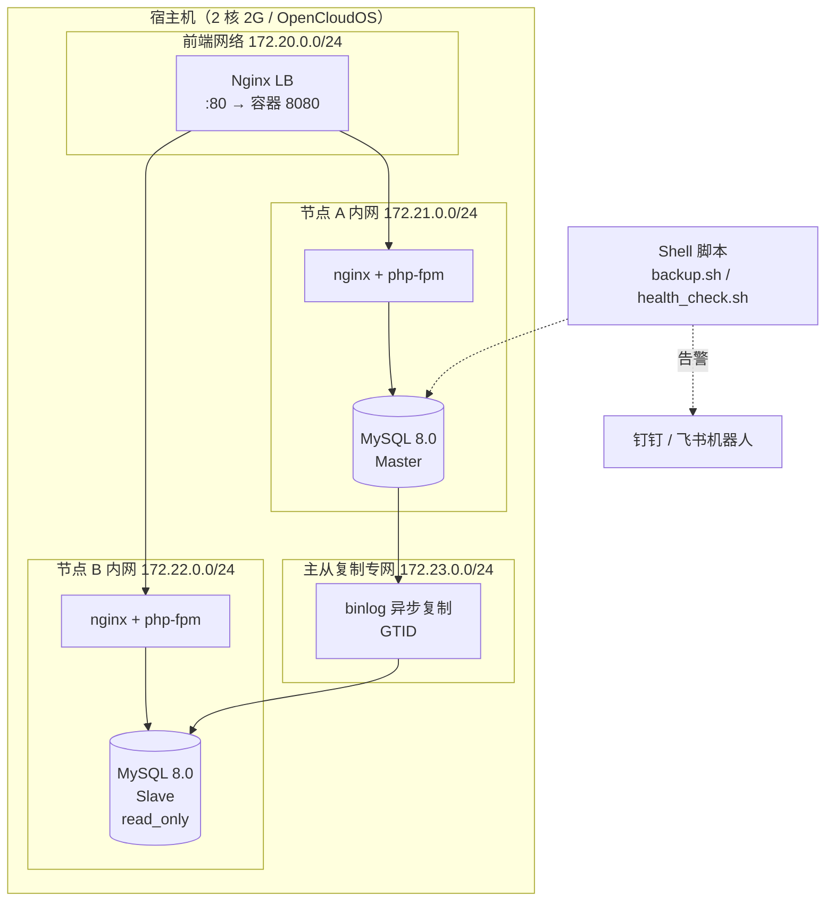

# 架构说明与设计取舍

> 这一页回答「为什么这么设计」，面试被问到架构决策时照着讲。

---

## 项目一：高可用 Web 集群

### 拓扑

### 关键设计决策

| 决策 | 选择 | 为什么 / 代价 |
|---|---|---|
| 多机怎么来 | **Docker 网络命名空间**，不是虚拟机 | 轻量服务器不支持嵌套虚拟化，KVM 走不通。代价：内核与磁盘 IO 共享，**不是真多机** |
| 网络怎么切 | 4 个自定义 bridge | 前端 / 两个节点内网 / 主从专网；主从流量不占用业务网络，也便于用 `tcpdump` 单独抓复制包 |
| 调度算法 | `least_conn` | 后端是无状态 PHP，`least_conn` 比 `ip_hash` 更能应对长短请求混合 |
| 健康检查 | Nginx 被动检查（`max_fails` + `fail_timeout`） | 开源版 Nginx 没有主动健康检查，被动检查零成本；代价是**故障发现有一两个请求的延迟** |
| 复制方式 | GTID 异步 | 配置简单、切换时能自动定位位点；代价是**主库宕机有丢数据窗口** |
| 内存怎么省 | 每实例 buffer pool 96M、关 performance_schema、max_connections 60 | 双实例 + Nginx + PHP 要塞进 2G；代价是**性能数字不好看**，所以要说明这是受限于机型 |
| 两个项目 | **分时运行，不同时启动** | 2G 内存扛不住两套同时跑；这本身就是一个要讲的调度决策 |

### 明确没做的（主动说出来）

- **没有 VIP / Keepalived** → LB 是单点，LB 挂了整个服务不可用，演练手册里有这一项
- **没有自动故障转移** → `failover_drill.sh` 是手工切换，未做 MHA / Orchestrator 自动选主
- **没有做读写分离** → 从库只作备份与只读验证，业务没接

---

## 项目二：Docker Compose 编排 LNMP

### 拓扑

### 关键设计决策

| 决策 | 选择 | 为什么 |
|---|---|---|
| 一容器一进程 | nginx / php-fpm / mysql 各一个容器 | 符合容器最佳实践，便于单独扩缩和排错 |
| 服务依赖 | `depends_on` + `healthcheck` | 光有 `depends_on` 只保证「启动了」，不保证「能连」；healthcheck 才是真就绪 |
| 数据持久化 | named volume，不用 bind mount 直接挂配置文件目录 | 避免宿主机目录属主问题（MySQL uid 999 那个坑） |
| 慢 SQL 定位 | 造 10 万行数据 + `EXPLAIN` + 慢日志 | 没有真实流量的话，只能自己造数据，才有对比基准 |
| 备份 | 逻辑备份 `mysqldump` | 数据量小够用；**大库应该用 XtraBackup 物理备份**，这点要主动讲 |

---

## 两个项目的内存账（面试能讲的数字）

| 组件 | 项目一（同时运行） | 项目二（单独运行） |
|---|---|---|
| Nginx | ~15MB × 3 | ~15MB |
| PHP-FPM | ~40MB × 2 | ~40MB |
| MySQL | ~220MB × 2 | ~280MB |
| 系统 + Docker | ~400MB | ~400MB |
| **合计（约）** | **~1.1 GB** | **~0.8 GB** |
| 2G 内存余量 | 紧张（靠 2G swap 兜底） | 较宽松 |

> swap 是必加的：备份时 `mysqldump` 峰值内存会顶上去，没有 swap 会被内核 OOM kill。
