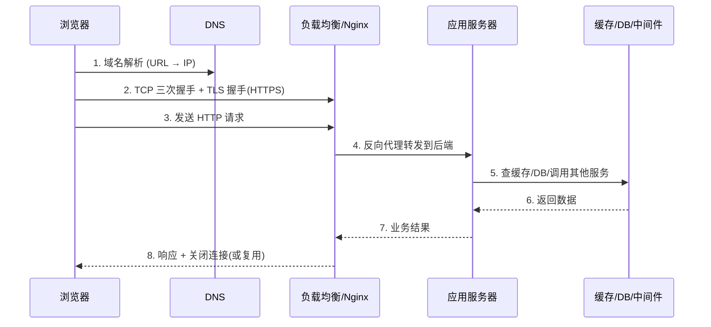
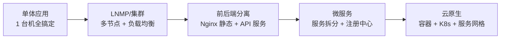
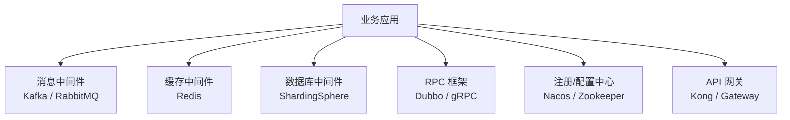

# 03 · Web 服务与中间件

> **定位**：Web 服务 + 中间件的概念底座（HTTP、反向代理、MQ、Redis、注册中心、网关）15 题。
> **用法**：先把概念讲清楚，再用追问逼深度。★ = 高危 / 必背。
> 负载均衡实战见 `04-负载均衡与SQL.md`，索引见 `README.md`。

---

## 一、Web 服务基础

### Q1 什么是 Web 服务？

> 「Web 服务 = 让别人能通过 **HTTP/HTTPS 协议 + 网络** 来访问的一段程序。
> 客户端（浏览器 / App / 别的程序）发请求，服务端处理并返回结果。」

要点：
- **本质是「请求—响应」模型**，无状态（每次请求独立，靠 Cookie / Token / Session 维持状态）。
- 不只是「网页」：REST 接口、文件下载、WebSocket 推送、gRPC 调用，底层都是 Web 服务。
- 与「中间件」的关系：Web 服务是**业务入口**，中间件是**它背后撑腰的基础设施**。

---

### Q2 ★ 一次 HTTP 请求从浏览器到返回，经历了什么？

> ★ 这是「八股之王」。从**网络 + 服务两层**讲，别只背到 TCP 握手就停。

分层记忆（面试按这个顺序说）：
1. **DNS**：域名 → IP（可能走本地 hosts / 递归解析 / CDN）。
2. **建连**：TCP 三次握手；HTTPS 再多一层 TLS 握手（证书校验、密钥协商）。
3. **请求**：浏览器按 HTTP 方法（GET/POST…）、Header、Cookie 发请求。
4. **接入层**：Nginx 做反向代理 / 负载均衡，把请求转给后端。
5. **应用层**：应用服务器（Tomcat / php-fpm / Node…）处理业务逻辑。
6. **数据层**：查缓存（Redis）、查库（MySQL）、调消息队列或其他微服务。
7. **返回**：原路返回，浏览器渲染（或调用方解析 JSON）。

| 追问 | 答点 |
|---|---|
| 为什么是三次握手不是两次？ | 防止已失效的连接请求突然又传到服务端，造成资源浪费；双向确认收发能力 |
| HTTPS 比 HTTP 多了什么？ | TLS 加密 + 证书身份认证 + 完整性校验；端口 443，性能损耗主要在握手 |
| 长连接（keep-alive）有什么用？ | 复用 TCP 连接，省去重复握手开销；高并发下显著降低延迟 |

---

### Q3 Web 服务器 vs 应用服务器，区别？

> 「**Web 服务器**（Nginx / Apache）擅长「接流量、转请求、发静态文件」；
> **应用服务器**（Tomcat / Jetty / php-fpm）擅长「跑业务代码、处理动态逻辑」。」

| 维度 | Web 服务器（Nginx） | 应用服务器（Tomcat） |
|---|---|---|
| 强项 | 高并发静态资源、反向代理、负载均衡 | 执行 Java/PHP/… 业务代码 |
| 并发模型 | 事件驱动（epoll），单机扛万级连接 | 线程 / 协程模型 |
| 典型分工 | 挡在最前面，把动态请求 `proxy_pass` 给后端 | 真正运行业务逻辑，返回 HTML/JSON |

> 实战里常见组合：**Nginx（反向代理 + 静态） → Tomcat / php-fpm（动态业务）**。
> 你项目里就是 Nginx LB + php-fpm 节点，正是这个结构。

---

### Q4 Web 架构是怎么演进的？

- **单体**：全部塞一台机，简单但不好扩展、一挂全挂。
- **集群 / 前后端分离**：静态归 Nginx，动态归多台后端，负载均衡扛量。
- **微服务**：按业务拆成多个服务，各自部署、独立伸缩，靠 RPC + 注册中心协作。
- **云原生**：容器化 + 编排（K8s），弹性伸缩、故障自愈。

---

## 二、核心 Web 组件与协议

### Q5 什么是反向代理？和正向代理区别？

| | 正向代理 | 反向代理 |
|---|---|---|
| 代理谁 | 客户端（替用户访问外网） | 服务端（替服务器接请求） |
| 使用者 | 客户端知道自己用了代理 | 客户端无感知 |
| 例子 | 公司内网翻墙代理 | Nginx 把请求转给后端集群 |

> 反向代理解决了三件事：**隐藏后端 IP**、**负载均衡**、**统一入口（SSL 卸载 / 限流 / 缓存）**。

### Q6 RESTful 和 RPC 有什么区别？

| 维度 | REST（HTTP 风格） | RPC（远程调用） |
|---|---|---|
| 定位 | 面向「资源」，用 URL + 方法 | 面向「动作 / 方法调用」 |
| 协议 | HTTP/HTTPS | 可跑在 HTTP/TCP 上（gRPC 用 HTTP/2） |
| 传输 | JSON / XML | 常是二进制（Protobuf），更高效 |
| 场景 | 对外暴露的开放 API | 内部微服务之间的高频调用 |

> 一句话：**对外用 REST 方便生态对接，对内用 RPC 图性能和强类型。**

---

## 三、中间件总览

### Q7 什么是中间件？它解决什么问题？

> 「中间件 = 处在『应用』和『底层资源（网络 / 磁盘 / 数据库）』之间的**通用基础软件**，
> 把『通信、缓存、消息、协调』这些重复造轮子的事统一搞定。」

它的价值：**解耦、异步、削峰、复用、治理**。

---

## 四、消息队列（MQ）

### Q8 ★ 为什么要用消息队列？

> ★ 三个核心场景，面试必说：

1. **异步**：下单后发短信 / 扣积分，不用同步等，主流程秒回。
2. **解耦**：A 系统只管发消息，B/C 系统自己订阅，互不直接依赖。
3. **削峰填谷**：秒杀瞬时万级请求，MQ 先扛住排队，后端按能力消费，保护数据库。

| 主流 MQ | 特点 | 适用 |
|---|---|---|
| **Kafka** | 高吞吐、持久化、分区有序 | 日志、大数据管道、高并发 |
| **RabbitMQ** | 路由灵活、易用 | 业务解耦、延迟低 |
| **RocketMQ** | 阿里系，事务消息强 | 电商订单、金融场景 |

### Q9 ★ MQ 常见问题怎么破？

| 问题 | 表现 | 解法 |
|---|---|---|
| **消息丢失** | 消息发了但没消费到 | 生产端确认 + 服务端持久化 + 消费端手动 ACK |
| **重复消费** | 同条消息被处理多次 | 消费端做**幂等**（唯一 ID + 去重表） |
| **消息顺序** | 顺序乱了（如订单状态） | 单分区 / 单队列顺序消费；或按业务键哈希 |
| **消息积压** | 消费跟不上生产 | 加消费者、提升消费能力、紧急扩容、丢弃非核心 |

> 幂等是最常被追问的点：**「同样的请求来一百次，结果只能生效一次」**，靠唯一键 / 状态机 / 去重表实现。

---

## 五、缓存（以 Redis 为例）

### Q10 ★ 为什么用缓存？缓存三兄弟是什么？

> 缓存解决「**读多写少、DB 扛不住热点**」的问题，把数据放更快的介质（内存）。

**缓存三兄弟（面试必考）：**

| 问题 | 原因 | 解法 |
|---|---|---|
| **缓存穿透** | 查**不存在的数据**，缓存和 DB 都没有，每次打到 DB | ① 缓存空值（短 TTL）② 布隆过滤器拦截 |
| **缓存击穿** | **某个热点 key 过期瞬间**，大量请求同时击穿到 DB | ① 互斥锁（只放一个去查）② 热点 key 不过期 |
| **缓存雪崩** | **大量 key 同时过期 / Redis 挂了**，DB 被冲垮 | ① 过期时间加随机抖动 ② 多级缓存 ③ 集群高可用 |

> 记忆口诀：**穿透=查空值/布隆；击穿=单点热点加锁；雪崩=过期错峰+高可用**。

### Q11 缓存和数据库的一致性问题？

- **读**：先查缓存，没有再查 DB 并写回缓存。
- **写**：争议点。常见方案「**先更新 DB，再删缓存（Cache-Aside）**」，配合「延迟双删」降低窗口。
- 强一致很难，通常追求「**最终一致**」；金融级场景才上分布式事务。

---

## 六、数据库中间件

### Q12 读写分离、分库分表是什么？

- **读写分离**：主库写、从库读，用中间件（MyCat / ShardingSphere / ProxySQL）把读流量导到从库，扛住读多场景（你项目就是 MySQL 主从）。
- **分库分表**：
  - **垂直**：按业务拆（用户库 / 订单库）。
  - **水平**：同一张表按 `user_id % N` 或按范围拆到多张 / 多库，解决单表太大。
- **痛点**：跨库 JOIN、分布式事务、全局 ID、分页排序都变复杂。

> 你的项目已经用 **MySQL 主从 + 复制专网**，讲读写分离时直接拿自己项目举例即可。

---

## 七、注册中心 & 配置中心

### Q13 为什么微服务需要注册中心和配置中心？

- **注册中心**（Nacos / Zookeeper / Consul / Eureka）：服务启动时「**上报地址**」，调用方「**实时发现**」对方在哪，下线自动摘除。解决「服务地址写死、扩缩容要改配置」的问题。
- **配置中心**（Nacos / Apollo）：配置集中管理、动态推送，改配置不用重启服务。

| 组件 | 角色 |
|---|---|
| Nacos | 注册 + 配置，二合一，国内主流 |
| Zookeeper | 强一致 CP，Dubbo 经典搭档 |
| Consul | 多数据中心、健康检查强 |

---

## 八、RPC 框架与 API 网关

### Q14 Dubbo / gRPC 是什么？

- **RPC**：让「调用远程服务」像「调用本地函数」一样。Dubbo（Java 生态、TCP + Hessian）、gRPC（跨语言、HTTP/2 + Protobuf）。
- 配套：**注册中心**（找服务）+ **负载均衡**（选节点）+ **容错**（重试 / 熔断）。

### Q15 API 网关是干什么的？

> 「网关 = 系统的**统一大门**，所有外部请求先过它。」

职责：**鉴权、限流、路由转发、灰度、日志、协议转换**。
常见：Kong、Spring Cloud Gateway、Nginx + Lua（OpenResty）。
和「反向代理」关系：网关是「带业务能力的反向代理」，反向代理是网关的子集。

---

## 九、容器与编排（你的项目已在用）

- **Docker**：把应用 + 依赖打包成镜像，环境一致、「一次构建到处跑」。你项目用 Docker 网络命名空间模拟多机。
- **Kubernetes（K8s）**：容器编排，负责**调度、扩缩容、自愈、服务发现**。微服务规模的标配。
- **关系**：Docker 解决「怎么打包」，K8s 解决「怎么管一堆容器」。

---

## 十、高频速记表

| 主题 | 一句话记忆 |
|---|---|
| Web 服务 | 基于 HTTP 的请求—响应模型，业务入口 |
| 反向代理 | 替服务端接请求：隐藏后端 + 负载均衡 + 统一入口 |
| Web vs 应用服务器 | Nginx 接流量，Tomcat/php-fpm 跑业务 |
| 消息队列 | 异步、解耦、削峰；幂等 + 不丢 + 有序 |
| 缓存穿透 | 查不存在 → 布隆过滤器 / 缓存空值 |
| 缓存击穿 | 热点 key 过期 → 互斥锁 / 不过期 |
| 缓存雪崩 | 批量过期 → 过期错峰 + 高可用 |
| 读写分离 | 主写从读，中间件路由 |
| 注册中心 | 服务地址自动注册与发现 |
| 网关 | 统一大门：鉴权 / 限流 / 路由 |
| 容器 | Docker 打包，K8s 编排 |

---

## 十一、和你项目的结合点（面试时这样讲）

- **你的集群**：Nginx LB + 双节点（php-fpm）+ MySQL 主从 → 覆盖「反向代理 / 负载均衡 / Web vs 应用服务器 / 读写分离」。
- **Docker 网络命名空间**：用容器模拟多机，对应「容器与编排」概念。
- **主从复制专网**：对应「数据库中间件 / 读写分离」的数据同步底座。
- **Shell 备份 + 健康检查 + 告警机器人**：对应「可观测 / 运维」侧，是中间件之外不可或缺的保障层。

> 建议：每项中间件概念，都试着回扣到「我的项目里有没有对应实践」，有实践的话说服力直接拉满。

---

## 参考学习路径

1. 先把「一次请求的生命周期」画熟（Q2）。
2. 再吃透缓存三兄弟、MQ 三问题（最高频）。
3. 然后逐个中间件「它解决什么痛点」。
4. 最后用你自己的项目做串联演示。
